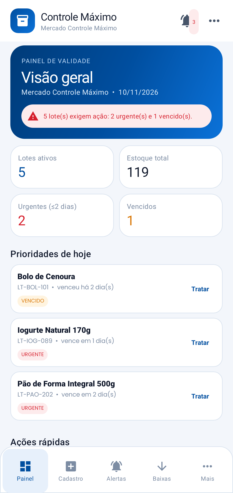
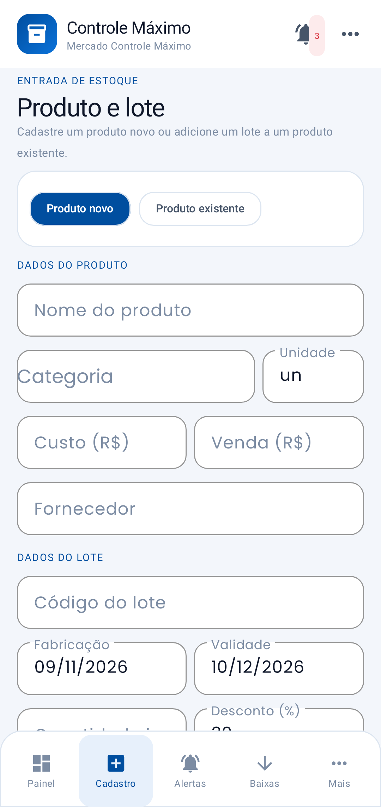
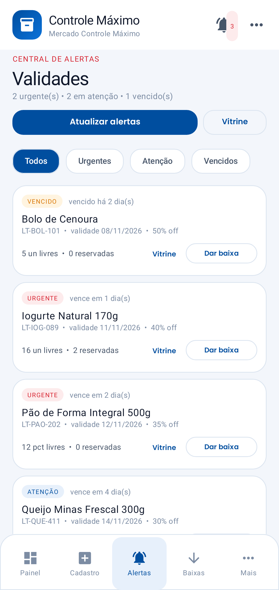
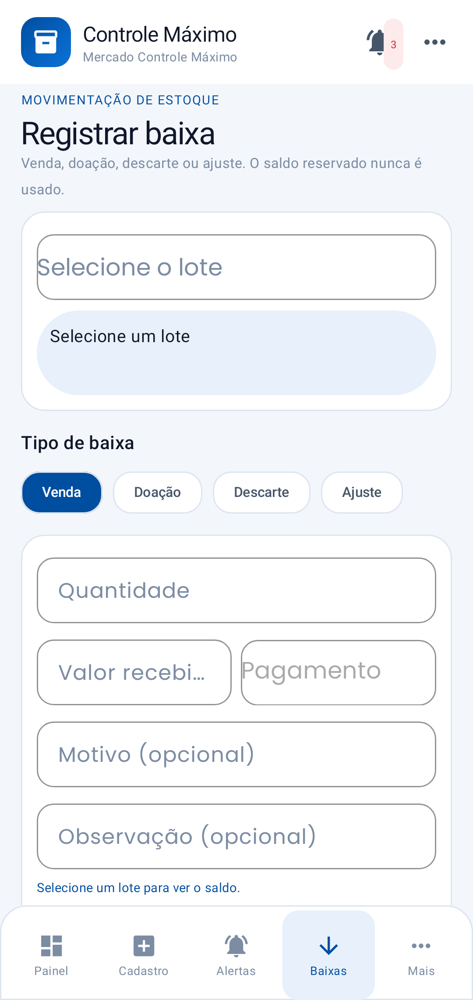
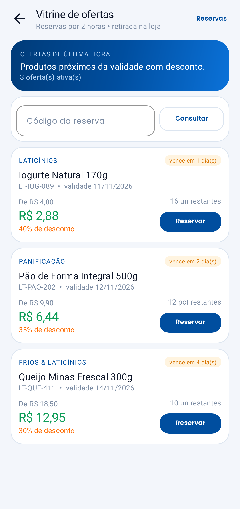
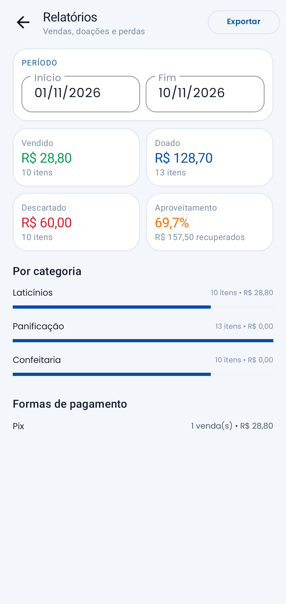
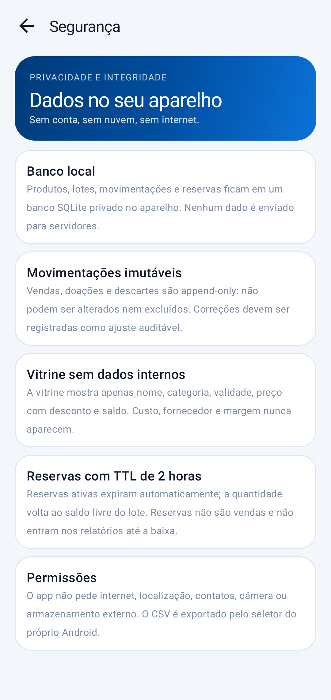

# Controle Máximo — Android nativo

[](https://github.com/aldecirv/controle-maximo-android/releases/latest)
[](https://github.com/aldecirv/controle-maximo-android/actions/workflows/build.yml)

**Gestão de validade, perdas e ofertas de última hora para pequenos comércios.**

MVP Android nativo em **Kotlin + XML + Material 3**, feito a partir do projeto **Controle Máximo** (React + servidor SQLite) e funcionando **100% offline** com banco SQLite local.



## Funcionalidades

- **Painel**: lotes ativos, estoque, urgentes, vencidos, prioridades, próximos vencimentos, últimas movimentações e ações rápidas.
- **Cadastro**: produto novo ou lote em produto existente; nome, categoria, unidade, custo, preço, fornecedor, código do lote, datas, quantidade e desconto.
- **Alertas**: classificação em **ATENÇÃO**, **URGENTE** e **VENCIDO** conforme prazos configuráveis; filtros; atualização dos alertas; ações de baixa/vitrine.
- **Baixas**: venda, doação, descarte e ajuste; valor recebido, forma de pagamento, instituição de doação, motivo e observação. O saldo reservado é respeitado.
- **Vitrine**: ofertas de lotes próximos da validade, preço original/desconto, reserva com nome/telefone, código `CMC-XXXXXX`, TTL de **2 horas** e consulta de reserva.
- **Relatórios**: período, vendido/doado/descartado, aproveitamento, valor recuperado, categorias, formas de pagamento e **exportação CSV** via seletor do Android.
- **Segurança**: banco local, sem internet, movimentações append-only, DTO público sem custo/fornecedor e TTL de reservas.
- **Ajustes**: nome da loja, prazos de atenção/urgência/vitrine, desconto padrão e restauração/limpeza dos dados de demonstração.

| Cadastro | Alertas | Baixas |
|---|---|---|
|  |  |  |

| Vitrine | Relatórios | Segurança |
|---|---|---|
|  |  |  |

## Regras de negócio implementadas

- Validade **estritamente posterior** à fabricação.
- Alerta:
  - `dias < 0` → **VENCIDO**
  - `dias <= dias_urgente` → **URGENTE**
  - `dias <= dias_atencao` → **ATENÇÃO**
  - acima → sem alerta.
- Baixa de venda/doação/descarte bloqueada se exceder `quantidade_disponivel - quantidade_reservada`.
- Ajuste registra uma correção auditável e não pode alterar/excluir movimentações.
- Movimentações são **append-only** (triggers SQLite bloqueiam UPDATE/DELETE).
- Reservas ativas expiram após 2 horas e devolvem a quantidade ao saldo livre.
- Relatórios usam os valores reais das movimentações; venda sem valor informado usa preço com desconto.
- A vitrine nunca expõe custo, fornecedor ou margem.

## Dados de demonstração

Na primeira execução o app cria produtos e lotes de exemplo para o MVP ser navegável. Em **Ajustes > Dados locais** é possível restaurar os exemplos ou apagar tudo. Em um uso real, comece com “Apagar todos os dados”.

## Privacidade

- **Sem permissão de internet**, sem conta, anúncios ou telemetria.
- SQLite privado no aparelho; `allowBackup=false`.
- CSV é gerado no cache e compartilhado somente pelo seletor do Android.
- Não há envio de e-mail/push nesta versão; os prazos e alertas são locais.

## Arquitetura

```
app/src/main/java/com/controlemaximo/app/
├── data/        Models, InventoryDb (SQLite), AlertEngine
├── ui/          MainActivity, Showcase, Reports, Security, Settings
│   ├── fragments/ Dashboard, Register, Alerts, Movements
│   ├── adapters/ Alert, Offer
│   └── MoreSheet
└── util/
```

- Kotlin, `minSdk 26`, `targetSdk 35`, ViewBinding, Material 3.
- Sem servidor: o app é a versão local do MVP; cada aparelho tem seu próprio banco.
- Fonte Poppins (SIL OFL).

## Build

```bash
export JAVA_HOME=/caminho/para/jdk-17
gradle :app:assembleDebug
```

Release assinado usa os secrets `AURORA_*` no CI.

Testes:

```bash
gradle :app:testDebugUnitTest
```

Cobrem níveis de alerta, bloqueio por reservas, vendas/doações/descarte, TTL de reserva, validação de datas/ajustes, seed e screenshots Robolectric.

## Limitações

- MVP single-tenant/local: não há login, multiusuário, sincronização entre aparelhos nem URL pública `/ofertas` servida por servidor.
- E-mail/push do projeto original não foram implementados; os alertas são visíveis no app.
- A vitrine é local no aparelho, sem rate limiting de IP.
- A validação foi feita com testes automatizados/Robolectric; não havia dispositivo Android físico conectado neste ambiente.
- Recomenda-se testar em um comércio real antes de usar como sistema de produção.

## Versão

**1.0.0** — MVP Android nativo do Controle Máximo com painel, cadastro, alertas, baixas auditáveis, vitrine com reservas de 2h, relatórios e CSV.

APK: [**controle-maximo-1.0.0.apk**](https://github.com/aldecirv/controle-maximo-android/releases/download/v1.0.0/controle-maximo-1.0.0.apk) · [Release v1.0.0](https://github.com/aldecirv/controle-maximo-android/releases/tag/v1.0.0)
